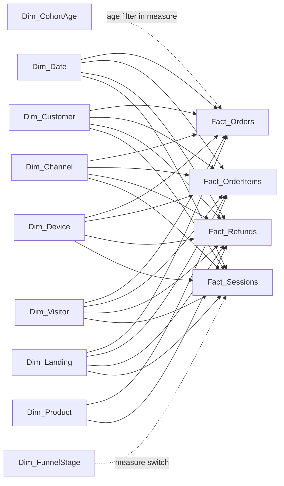

# Model architecture and relationships

Import model with four independent native-grain facts and conformed dimensions. All 26 relationships are active, one-to-many, and filter from dimension to fact. There are no fact-to-fact relationships.

| Fact | Grain | Date role | Rows |
|---|---|---|---:|
| Fact_Orders | One recorded order | Order Date | 32,313 |
| Fact_OrderItems | One sold item | Order Date | 40,025 |
| Fact_Refunds | One recorded refund event | Refund Date | 1,731 |
| Fact_Sessions | One website session with journey flags | Session Date | 472,871 |

Product filters items and refunds. It does not classify whole orders by primary product. Gross Sales, COGS, Orders and AOV are whole-order metrics. Product measures use sold-item values. Net Revenue, Gross Profit After Refunds and Refund Amount % use matching item financials and refund scope so product selections cannot mix all-product sales with selected-product refunds. Without a product filter item sales/COGS reconcile exactly to orders.

On the Revenue page, product comparisons do not cross-filter whole-order headline cards, financial trend or monthly comparisons; the product evidence zone remains interactive. On the Product page, whole-order basket/attach-rate metrics remain whole-order metrics and the page footnote states that scope.

## Relationship inventory

| Dimension key | Fact key | Cardinality | Direction |
|---|---|---|---|
| Dim_Date[Date] | Fact_Orders[Order Date] | 1 → many | Dimension → fact |
| Dim_Customer[Customer ID] | Fact_Orders[Customer ID] | 1 → many | Dimension → fact |
| Dim_Channel[Channel ID] | Fact_Orders[Channel ID] | 1 → many | Dimension → fact |
| Dim_Device[Device] | Fact_Orders[Device] | 1 → many | Dimension → fact |
| Dim_Visitor[Visitor Type] | Fact_Orders[Visitor Type] | 1 → many | Dimension → fact |
| Dim_Landing[Landing Page] | Fact_Orders[Landing Page] | 1 → many | Dimension → fact |
| Dim_Date[Date] | Fact_OrderItems[Order Date] | 1 → many | Dimension → fact |
| Dim_Customer[Customer ID] | Fact_OrderItems[Customer ID] | 1 → many | Dimension → fact |
| Dim_Channel[Channel ID] | Fact_OrderItems[Channel ID] | 1 → many | Dimension → fact |
| Dim_Device[Device] | Fact_OrderItems[Device] | 1 → many | Dimension → fact |
| Dim_Visitor[Visitor Type] | Fact_OrderItems[Visitor Type] | 1 → many | Dimension → fact |
| Dim_Landing[Landing Page] | Fact_OrderItems[Landing Page] | 1 → many | Dimension → fact |
| Dim_Date[Date] | Fact_Refunds[Refund Date] | 1 → many | Dimension → fact |
| Dim_Customer[Customer ID] | Fact_Refunds[Customer ID] | 1 → many | Dimension → fact |
| Dim_Channel[Channel ID] | Fact_Refunds[Channel ID] | 1 → many | Dimension → fact |
| Dim_Device[Device] | Fact_Refunds[Device] | 1 → many | Dimension → fact |
| Dim_Visitor[Visitor Type] | Fact_Refunds[Visitor Type] | 1 → many | Dimension → fact |
| Dim_Landing[Landing Page] | Fact_Refunds[Landing Page] | 1 → many | Dimension → fact |
| Dim_Date[Date] | Fact_Sessions[Session Date] | 1 → many | Dimension → fact |
| Dim_Customer[Customer ID] | Fact_Sessions[Customer ID] | 1 → many | Dimension → fact |
| Dim_Channel[Channel ID] | Fact_Sessions[Channel ID] | 1 → many | Dimension → fact |
| Dim_Device[Device] | Fact_Sessions[Device] | 1 → many | Dimension → fact |
| Dim_Visitor[Visitor Type] | Fact_Sessions[Visitor Type] | 1 → many | Dimension → fact |
| Dim_Landing[Landing Page] | Fact_Sessions[Landing Page] | 1 → many | Dimension → fact |
| Dim_Product[Product ID] | Fact_OrderItems[Product ID] | 1 → many | Dimension → fact |
| Dim_Product[Product ID] | Fact_Refunds[Product ID] | 1 → many | Dimension → fact |

## Date and filter semantics

- Dim_Date is contiguous, marked using its unique Date key and Time table category; automatic date/time is disabled. Month names and Year-Month labels have explicit sort keys. The hierarchy is Year → Quarter → Month → Date.
- Sessions and campaign measures use the acquiring session date; order/item values use the recorded order date. Refund events use refund date. There are 237 cross-calendar-day session/order pairs.
- Refund incidence and recorded refunds on selected sales are original-sale-cohort measures. They observe all linked refund events through the extract cutoff, even when an event occurs after the selected sale period.
- Cohort retention ignores calendar-date and acquisition slicers. It retains first-purchase cohort/customer filters and blanks any age cell without a fully observed calendar month. Age 0 means purchase-month activity; a retained customer is a customer purchasing in a later month, not merely visiting.
- Dim_Customer lifetime frequency is fixed over the entire observed extract. The Repeat Purchasing Customers measure instead counts customers with at least two purchases inside the selected period.
- Disconnected utilities are deliberate. Funnel stage selection changes the stage-switch measure; it does not directly filter native facts. Cohort age acts only inside the cohort activity measure.

## Power Query and preparation boundary

Power Query reads the deterministic prepared CSVs using a single PreparedFolder parameter, promotes headers and applies explicit culture-aware integer, currency, date and text types. Raw event ordering, safe many-to-one enrichments, basket signatures and cohort derivation are implemented in the reproducible preparation script, not hidden in DAX. The heavy 1.19-million-row event table is retained as raw evidence and reduced to 472,871 session rows for Import performance. This is a deliberate hybrid ETL design; refresh the preparation step when sources change, then refresh Power BI.