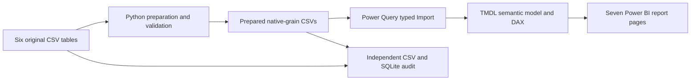

# Maven Fuzzy Factory · E-Commerce Intelligence

A Power BI portfolio project connecting financial performance, acquisition quality, conversion journeys, product economics and recorded refunds for a **fictional Maven Analytics retailer**.


**7 report pages · 88 DAX measures · 26 relationships · 472,871 sessions · 32,313 orders**

## Business problem

Management needs to understand which traffic converts, where the shopping journey loses sessions, how products contribute gross profit, and how refunds affect recorded revenue. The project answers these questions while preserving transaction grain and distinguishing order dates, session dates and refund dates.

## Explore the report

| Page | Decision supported |
|---|---|
| Executive Command Center | Assess recorded sales, gross profitability and conversion |
| Revenue & Profitability | Compare complete months, basket value and product economics |
| Marketing Acquisition | Evaluate source/campaign efficiency and device conversion |
| Conversion Funnel | Locate losses in an ordered, distinct-session shopping journey |
| Product & Basket | Compare products, additional items and observed combinations |
| Customer Behavior | Separate visitors from buyers and inspect purchase cohorts |
| Refunds & Business Risks | Track refund cash flow and original-sale-cohort incidence |

The native report includes date and acquisition slicers, context-aware titles, explanatory report-page tooltips, conditional formatting and product drillthrough. Slicers are page-local. Full manual click-through acceptance remains a documented limitation.

<details><summary>Conversion and product screenshots</summary>


</details>

[Browse all actual report captures](docs/screenshots/) · [Detailed walkthrough](Maven%20Fuzzy%20Factory/docs/07-report-walkthrough.md)

## Technology and architecture

**Power BI Desktop · PBIP/PBIR · TMDL · DAX · Power Query M · Python · pandas · NumPy · SQLite**

Four independent facts retain one order, one sold item, one refund event and one website session per row. Shared date, customer, channel, device, visitor and landing dimensions filter facts in one direction. Product filters item/refund facts. Disconnected stage and cohort-age tables drive explicit measures.



[Model relationships and grain documentation](Maven%20Fuzzy%20Factory/docs/05-model-and-relationships.md) · [KPI formulas](Maven%20Fuzzy%20Factory/docs/04-kpi-reference.csv)

[Download the interactive architecture diagram](docs/assets/analytics-pipeline.html) and open it locally. Generated with Archify; automated artifact and browser checks passed. The Mermaid overview above renders directly on GitHub.

## Verified results

| Full-extract metric | Value |
|---|---:|
| Recorded sales | $1,938,509.75 |
| Recorded COGS | $722,370.25 |
| Gross profit before refunds and operating expenses | $1,216,139.50 |
| Gross margin | 62.74% |
| Recorded refunds | $85,338.69 |
| Revenue after all recorded refunds | $1,853,171.06 |
| Session conversion | 6.83% |

Desktop conversion is 8.50% versus 3.09% on mobile. February 2015 recorded sales are 95.74% above February 2014. These observations support investigation; they do not establish causal device effects or realized improvements.

Sales/sessions span March 19, 2012–March 19, 2015; refunds extend through April 1, 2015. Both boundary sales months are partial. Gross profit is not operating/net profit. Traffic tagging does not prove paid status; advertising spend, ROAS and CAC are unavailable. [Evidence and recommendations](Maven%20Fuzzy%20Factory/docs/06-business-insights.md).

## Run locally

1. Clone or download this repository. Install a current Power BI Desktop version supporting PBIP/TMDL.
2. Install Python dependencies and configure this clone:

   ```powershell
   python -m pip install -r requirements.txt
   python scripts/configure_local.py
   ```

3. Open [`Maven Fuzzy Factory.pbip`](Maven%20Fuzzy%20Factory/powerbi/Maven%20Fuzzy%20Factory.pbip) and refresh the Import model. `PreparedFolder` is configured by the preceding script; it can also be set in Manage parameters.
4. Navigate the seven pages. In Desktop editing mode, action buttons require Ctrl+click.

Prepared CSVs and the authored model are included. To refresh changed raw files, run `python scripts/profile_and_prepare.py` first, then refresh Power BI. This is a documented hybrid Python/Power Query pipeline, not a raw-CSV-only one-click refresh. Model/report authoring scripts are optional and can regenerate artifacts; see [build instructions](scripts/README.md).

## Validation

The original Desktop acceptance run on **October 21, 2026** completed full Import refresh, executed all 88 measures, and passed **903 reference comparisons** across totals, months, products, devices, funnel stages, cohorts and edge cases. A separate audit passed **54 checks**, including 299 filtered aggregate cells. Static artifact checks passed **51 checks**. All 15 main/support pages were captured from the actual report.

Reproduce data and saved-engine-evidence checks:

```powershell
python scripts/independent_validate.py
python scripts/verify_live.py
```

`verify_live.py` checks saved Desktop results; it does **not** start or query a live engine. Runtime queries are supplied under `Maven Fuzzy Factory/qa/`. [Validation scope and limits](Maven%20Fuzzy%20Factory/docs/08-validation-and-runtime.md).

## Live demonstration

This is a native Power BI project, not a deployed web application. The public alternative is the screenshot gallery and the reproducible PBIP. No public Power BI Service URL is claimed. Publishing an interactive Power BI report requires a suitable account/workspace and sharing configuration.

## Data and attribution

Source: [Maven Analytics — Toy Store E-Commerce Database](https://mavenanalytics.io/data-playground/toy-store-e-commerce-database). The provider lists the dataset as **Public Domain**, rechecked November 12, 2026. Original CSV bytes are preserved and fingerprinted. The company and transactions are educational source data, not a real client engagement. Generated code has no separately granted open-source license; dataset terms do not automatically license project code.

## Author

[matolba97](https://github.com/matolba97) — Power BI and e-commerce analytics portfolio.
